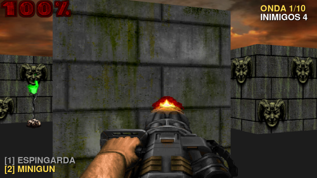
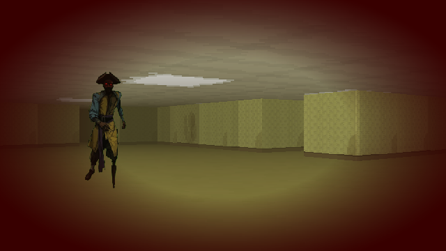

# GamePython

Um portátil retrô feito em **React** que roda jogos escritos em **Python** direto no navegador, sem servidor.
O Python roda com o [Pyodide](https://pyodide.org) (Python compilado para WebAssembly), e os jogos de pygame desenham dentro da tela do portátil.

## ▶ Jogar online

**https://zalone03.github.io/GamePython/**

Funciona no **Chrome** ou no **Edge** atualizados. Na primeira vez o Python é baixado (alguns segundos) e depois fica no cache do navegador.

| DOOM STYLE GAME | BACKROOMS |
|---|---|
|  |  |

## Jogos

| Jogo | O que é | Controles |
|---|---|---|
| **DOOM STYLE GAME** | Sobreviva a 10 ondas de monstros, com espingarda e minigun. Feito por [StanislavPetrovV](https://github.com/StanislavPetrovV) | Clique na tela, WASD anda, mouse mira, clique atira, 1/2 troca arma |
| **BACKROOMS** | Ache a porta de saída num mapa infinito antes que o Captain Clark te pegue. Normal, Médio e Difícil | Clique na tela, WASD anda, mouse/setas giram, Shift corre |
| **ADIVINHA O NÚMERO** | Descubra o número secreto antes das tentativas acabarem | Digite e aperte ENTER |
| **FORCA** | Adivinhe a palavra, letra por letra | Digite e aperte ENTER |
| **SNAKE** | Coma as maçãs e fuja dos obstáculos | Setas |

No portátil: **↑/↓** escolhem o jogo, **ENTER** joga e **ESC** sai. Quando um jogo termina, **ENTER** joga de novo.
No celular aparecem a cruz direcional e os botões A/B.

## Rodar no computador

### O portátil (site)

```powershell
cd web
npm install
npm run dev
```

Depois abra http://localhost:5173.

### Os jogos direto no Python

Precisa do pygame: `pip install pygame-ce`. Cada comando roda a partir da pasta do projeto:

```powershell
python forca.py
python Adivinha.py
python Snake.py
```

```powershell
cd doom; python main.py
```

```powershell
cd backrooms; python main.py
```

## Como funciona

- O site (`web/`) é React + Vite. O motor (`web/src/python/`) carrega o Pyodide e roda os `.py` sem mudar o código deles:
  - `input()` e `time.sleep()` são trocados por versões que esperam o navegador;
  - o relógio do pygame acompanha o ritmo do monitor;
  - os jogos com pasta própria (DOOM e Backrooms) são copiados para um disco virtual antes de rodar.
- O catálogo de jogos fica em `web/src/jogos/catalogo.js`. Para adicionar um jogo, é só colocar mais um item lá.
- As Backrooms geram o mapa sala por sala (infinito, sempre com passagem). As imagens e os sons saem das ferramentas em `backrooms/ferramentas/`.

## Pastas

```
Adivinha.py, forca.py, Snake.py   jogos de um arquivo só
doom/                             DOOM em ondas (código, imagens e sons)
backrooms/                        Backrooms
  originais/                      imagens originais (Clark, parede, porta, chão, teto, luz)
  imagens/ e sons/                o que o jogo usa
  ferramentas/                    preparar_imagens.py e gerar_sons.py (precisam de numpy)
web/                              o portátil em React
  src/componentes/                telas e controles
  src/hooks/                      lógica do portátil, abertura e teclado
  src/python/                     motor que roda o Python no navegador
  src/jogos/                      catálogo de jogos
  src/estilos/                    CSS
.github/workflows/pages.yml       publica o site no GitHub Pages
```

## Publicar no GitHub Pages

O workflow `.github/workflows/pages.yml` compila e publica o site a cada push na `main`.
Só na primeira vez: em **Settings → Pages → Build and deployment → Source**, escolha **GitHub Actions**.

## Créditos

- **DOOM STYLE GAME**: [StanislavPetrovV/DOOM-style-Game](https://github.com/StanislavPetrovV/DOOM-style-Game) (licença MIT, ver `doom/LICENSE`). Neste projeto ganhou ondas, minigun e o fim de jogo.
- Sprites da minigun: folha com a assinatura "T5F" (ver `doom/resources/sprites/weapon/minigun/CREDITOS.txt`).
- [Pyodide](https://pyodide.org) para rodar Python no navegador, e [pygame-ce](https://pyga.me).
